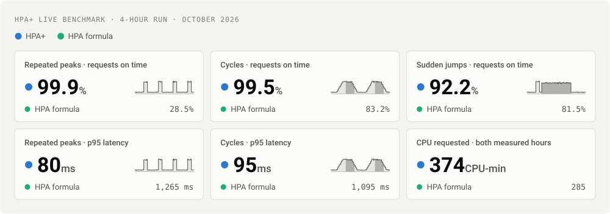
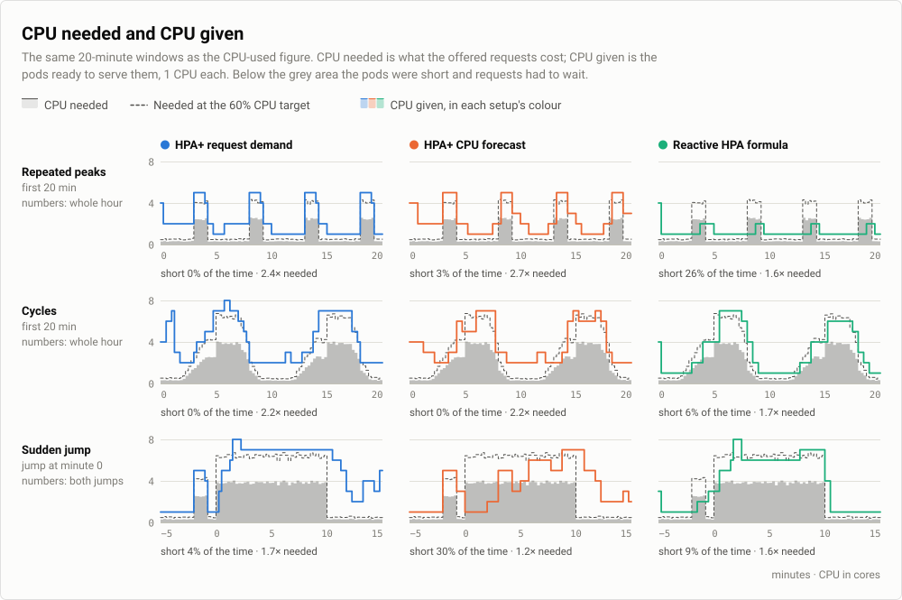
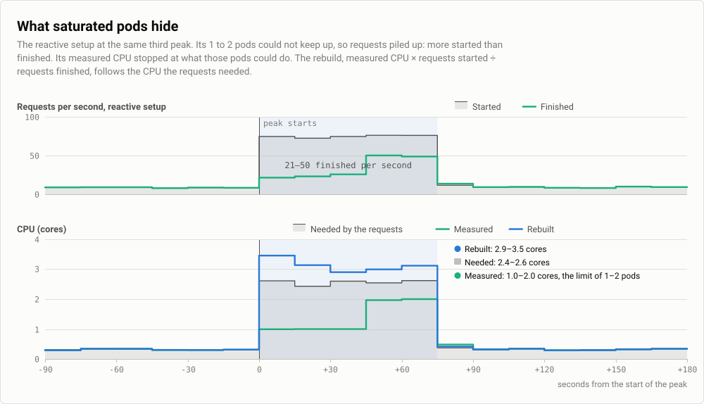

# HPA+

HPA+ is a Kubernetes predictive autoscaling operator. It keeps the familiar Horizontal Pod Autoscaler configuration and forecasts the CPU a workload needs. When pods are full, their measured CPU stops at what they can do and hides the rest. So by default HPA+ rebuilds the demand from request counters, as measured CPU × requests started ÷ requests finished, and a model forecasts that. The operator turns the forecast into replicas using CPU requests and the utilization target. Workloads without request counters can forecast measured CPU only, which does much worse.

Supported models are Linear, Holt-Winters, ARIMA/SARIMA, XGBoost, LightGBM, Toto, TiRex and a seasonal naive baseline. Models share history collection, workload identity checks, forecast validity checks, worker limits and the scaling decision path. Predictive performance depends on the workload, measurements and configuration.

Documentation: https://cslab-ntua.github.io/HPA-Plus/

## Results on synthetic traffic

In a 4-hour test on a live cluster, HPA+ with [request-demand forecasting](docs/user-guide/request-demand.md) answered 99.9% of requests within 500 ms during repeated traffic peaks. The Kubernetes HPA formula with the same scaling limits answered 28.5%. The [synthetic results](docs/results/synthetic.md) describe the setup, every number and the limits.



The same run as CPU needed by the requests against CPU given by ready pods. Below the grey area a setup was short and requests had to wait.



## How it works

When pods are full, requests start faster than they finish and the measured CPU stops at what the pods can do. The rebuild uses that gap:



1. Collect workload metrics and retain complete CPU observations in durable history.
2. Compute the reactive HPA-style recommendation and evaluate eligible models. With [request demand](docs/user-guide/request-demand.md), the default, each history window is first rebuilt as measured CPU × requests started ÷ requests finished. Models set to `cpuOnly` skip this step.
3. Convert forecast CPU demand into replicas, optionally combining it with the reactive recommendation through `includeHPA`.
4. Apply the configured decision policy, rollout mode, replica bounds and scaling behavior.
5. Update the workload's Scale resource and publish status, logs and operational metrics.

Sampling and reconciliation run independently. Missing CPU remains missing; forecasts have source timestamps and expiry. Timed predictive policies can preserve the forecast covering the current interval and defer future decreases until their interval begins.

The [architecture](docs/architecture.md) page shows where each step happens.

For all benchmark results, including real traffic, see [benchmark results](docs/results/README.md).

## Build and install

The operator requires Kubernetes 1.23 or newer (`autoscaling/v2`), Linux nodes with cgroup v2 for the CPU collector, and a Prometheus that scrapes your application's request counters. [Request demand](docs/user-guide/request-demand.md) lists what it needs. Installing or upgrading the chart needs cluster-admin rights, because it manages the CRD and cluster-wide RBAC. The supplied image targets Linux/amd64. Use an image tag that identifies your actual checkout:

```bash
export REGISTRY=your-registry
export VERSION=your-build-tag
make docker REGISTRY="$REGISTRY" VERSION="$VERSION"
make push REGISTRY="$REGISTRY" VERSION="$VERSION"
helm upgrade --install hpa-plus-operator ./helm \
  --namespace hpa-plus-system --create-namespace \
  --set image.repository="$REGISTRY/hpa-plus-operator" \
  --set image.tag="$VERSION" \
  --set trafficPrometheusURL="http://prometheus.monitoring.svc:9090"
```

Check that the operator is running and the CRD exists:

```bash
kubectl -n hpa-plus-system rollout status deployment/hpa-plus-operator
kubectl get crd hpapluses.hpa.plus
```

The Helm chart installs the CRD, operator and required permissions. Each `HPAPlus` belongs in the same namespace as its target workload. Start new configurations in `observe` mode and inspect their status before enabling control. Only one autoscaler should write a workload's replica count.

See [installation](docs/user-guide/installation.md), [getting started](docs/user-guide/getting-started.md), [configuration](docs/reference/configuration.md) and [models](docs/user-guide/models.md).

To watch what HPA+ decides and why, run `make ui` and open the address it prints. The [UI guide](docs/user-guide/ui.md) explains the read-only page.

## Development

Use the Go version declared in `go.mod` and the Python runtime/dependencies pinned by `Dockerfile` and `algorithms/requirements.txt`.

- `make build`: build the manager, the worker server and the cgroup collector.
- `make py_dependencies`: install the pinned model, docs and dev dependencies.
- `make test`: run the Go and Python unit tests (needs `make py_dependencies` first).
- `make docs`: build the docs site with the same checks as CI.
- `make generate`: regenerate deepcopy code, the CRD and operator RBAC.
- `make docker` / `make push`: build or publish an operator image.
- `make ui`: serve the read-only local UI on http://hpaplus.localtest.me:8080.

`pre-commit install` adds hooks that run whitespace checks, gofmt, go vet and go test before each commit.

The [architecture guide](docs/architecture.md) describes the controller, forecasting interface, history and worker boundaries. [Operations](docs/user-guide/operations.md) covers status, resources, logs and recovery.

## Attribution and license

HPA+ extends [Predictive Horizontal Pod Autoscaler](https://github.com/jthomperoo/predictive-horizontal-pod-autoscaler), created and maintained by Jamie Thompson (`jthomperoo`) and its upstream contributors. Their work and attribution are preserved under the [Apache License 2.0](LICENSE).
