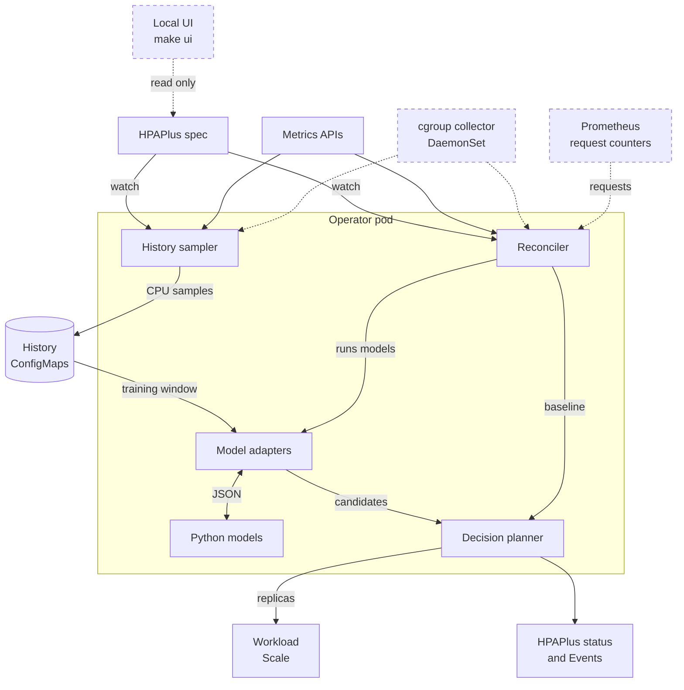
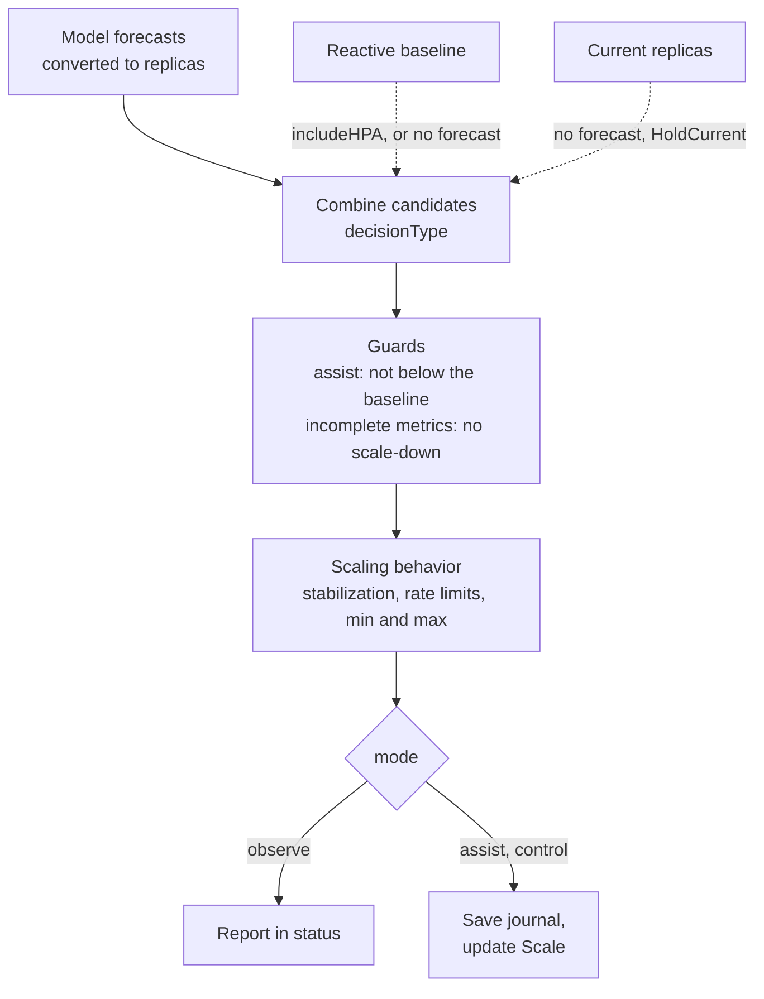

# Architecture

HPA+ is a Kubernetes operator. One manager pod watches `HPAPlus` resources and runs two loops for each of them: the
history sampler records CPU measurements, and the reconciler forecasts demand and sets the workload's replica count
through its Scale subresource. The models are bundled Python code that runs inside the manager container or in an
optional worker sidecar.

Dashed parts are optional. The cgroup collector and Prometheus are needed only for
[request-demand mode](user-guide/request-demand.md); the collector can also be the CPU source for every model. Python
runs in the manager container, or in a worker sidecar in the same pod. The history ConfigMaps also hold cached
forecasts and the scale journal. The local UI runs on your own machine and only reads.

## Components

| Path | What it does |
| --- | --- |
| `main.go` | Manager entry point: flags, wiring, leader election |
| `api/v1alpha1/` | HPAPlus spec and status types, defaults and generated deepcopy code |
| `internal/controllers/` | Reconciler, history sampler, history store, scale journal and recovery, request-demand orchestration, status |
| `internal/validation/` | Checks that the CRD schema cannot express, such as cross-field rules |
| `internal/decision/` | Candidate selection, rollout modes, guards and scaling behavior, with no clients or writes |
| `internal/scalebehavior/` | Kubernetes HPA stabilization and rate-limit rules |
| `internal/metrics/` | Metric gathering, pod CPU from Metrics Server, kubelet or the cgroup collector, and CPU request capacity |
| `internal/cgroup/`, `cmd/cgroup-collector/` | Optional DaemonSet that reads cgroup v2 counters and serves per-pod CPU snapshots |
| `internal/history/` | Persisted history format, validation and recovery rules |
| `internal/prediction/` | Model adapters, forecast timing and CPU-to-replica conversion |
| `internal/prediction/requestdemand/` | Request-rate forecasts for request-demand mode |
| `internal/workloaddemand/` | Prometheus request telemetry and online CPU-cost estimation |
| `internal/forecastquality/` | Forecast error tracking for `forecastReliability` |
| `internal/algorithm/`, `algorithms/` | Bounded Python process runner, and the Python models and protocol |
| `internal/worker/`, `cmd/worker-server/` | Optional worker sidecar that runs all Python behind a private Unix socket |
| `internal/hook/` | HTTP tuning hooks with an origin allowlist and optional credentials |
| `internal/observability/` | Prometheus metrics, structured logs and Kubernetes Events |
| `internal/ui/`, `cmd/hpaplus-ui/` | Read-only local web UI (`make ui`) |
| `internal/fake/` | Test fakes |
| `helm/` | Chart: operator deployment, CRD, RBAC, worker sidecar, cgroup collector and network policy |

## Sampling

The sampler wakes at each resource's sampling slot (`syncPeriod`, 15 seconds by default) and records one aggregate CPU
observation for the workload. It keeps only complete measurements: if a pod or container has no CPU sample, nothing is
recorded for that slot, and missing data never becomes zero. Each row keeps its source timestamp, and a measurement
that was already recorded is not stored again. A history belongs to one HPAPlus and one workload UID, so a recreated
or retargeted workload starts a new history.

CPU comes from the Metrics Server by default. `cpuHistorySource: kubelet` reads kubelet summaries through the node
proxy, and `cpuHistorySource: cgroup` reads the cgroup collector, which samples cgroup v2 counters on every node every
two seconds.

## Reconciliation and decisions

Each reconciliation validates the resource, resolves the target's Scale, checks the workload identity and finishes any
scale write that a restart interrupted. It then gathers the configured metrics, computes the reactive HPA
recommendation, loads the retained history and runs the models whose history, cadence and retry state allow it.

Models forecast CPU demand in millicores, not replicas. The runtime checks each forecast's source, unit, timestamps
and expiry, then converts it to replicas with the workload's CPU request per pod and utilization target. The planner
combines the candidates with `decisionType`. The reactive baseline joins them when `includeHPA` is true and replaces
them when no forecast is usable, unless `predictionFailurePolicy: HoldCurrent` keeps the current replica count instead.
`assist` mode never goes below the baseline, and incomplete metrics block scale-down. Stabilization windows, rate limits
and the replica bounds apply last, as in the Kubernetes HPA.

In `observe` mode the plan is only reported in status. In `assist` and `control` the controller first saves a scale
journal, then updates the Scale subresource. See [rollout modes](user-guide/rollout.md) and
[configuration](reference/configuration.md).

## Forecasting

Each model adapter (Linear, Holt-Winters, ARIMA/SARIMA, XGBoost and LightGBM) implements the same typed forecasting
interface. Python receives validated, timestamped CPU history and the model configuration over a versioned JSON
protocol, and returns CPU demand with its forecast time and provenance. Incremental ARIMA keeps a fitted session
between calls; the other models fit on every run.

A forecast always expires at its forecast horizon, and `predictionMaxAge` allows reusing it until then. Timed
policies (`predictivePolicy`) keep a short trajectory: they scale up within a lead time before a predicted rise and
never remove capacity before a predicted drop arrives. Optional reliability checks compare forecasts with the
measurements that follow and ask a degraded model to refit.

See [models](user-guide/models.md), [typed forecasting](reference/typed-forecasting.md),
[forecast policy](reference/forecast-policy.md) and [worker protocol](reference/worker-protocol.md).

## Request demand

CPU history cannot show demand that saturated pods failed to serve. Request-demand mode, an opt-in XGBoost option,
adds per-pod request counters from Prometheus. The reconciler queries them for the workload's own pods, learns the CPU
cost of a completed request from cgroup CPU measurements while the workload runs, and forecasts either incoming
requests or CPU demand rebuilt from them. Its learned state lives in its own ConfigMap. When request data or the
learned cost is unavailable, the model uses its CPU forecast, and without one it holds the current replica count. It
never falls back to the reactive recommendation.

See [request demand](user-guide/request-demand.md).

## History and scale accounting

Each HPAPlus has a `hpa-plus-<name>-data` ConfigMap. Small histories fit in it; larger ones move to immutable chunk
ConfigMaps listed in a versioned manifest in that root, up to 16 MiB per HPAPlus. Readers check ownership, identities,
sizes and hashes. Writes stage the complete new data first and then publish the manifest with a conditional update,
so a failed write leaves the previous history readable. Configured training windows are never shortened to save space.

Before changing Scale, the controller saves a journal of the intended change. After a restart, recovery accounts for
that change without replaying it. Kubernetes has no transaction across the HPAPlus, its history and the Scale
subresource, so identity, resource-version and freshness checks narrow the races instead.

See [history storage](reference/history-storage.md) and [history recovery](reference/history-recovery.md).

## Runtime and deployment

The operator image (Linux/amd64) contains the manager, the worker server, the cgroup collector and the pinned Python
models. Python runs in bounded processes: one-shot fits have a concurrency limit, incremental sessions have a cap,
every call has a deadline and an address-space limit, and numerical libraries use one thread. Failed fits back off per
model, and the backoff survives restarts.

With worker isolation enabled, all Python runs in a `model-workers` sidecar that the manager reaches over a private
Unix socket. The sidecar has its own CPU and memory limits and no Kubernetes credentials. If it is unavailable,
forecasts fail and the normal fallback applies; Python never runs in the manager instead.

The Helm chart enables leader election and uses a Recreate rollout. `--watch-namespace` limits the watched resources
but not the service account's permissions. Holt-Winters tuning hooks can only call HTTP(S) origins on the operator's
allowlist.

See [installation](user-guide/installation.md), [worker isolation](reference/worker-isolation.md),
[model runtime](reference/model-runtime.md), [RBAC](reference/rbac.md), [network policy](reference/network-policy.md)
and [hook security](reference/hook-security.md).

## Observability and the local UI

HPAPlus status reports metric availability, model warm-up and eligibility, failures and backoff, history capacity
and the latest decision. The manager writes JSON logs and rate-limited Kubernetes Events, and serves Prometheus
metrics on port 8080 (8082 for the worker sidecar).

`make ui` runs a read-only web page on your machine. It uses your kubeconfig to read HPAPlus objects, their scale
targets and history ConfigMaps, and shows each autoscaler's decisions, CPU and forecasts. Nothing is installed in the
cluster.

See [observability](user-guide/observability.md), [decision reporting](reference/decision-reporting.md),
[operations](user-guide/operations.md) and the [local UI](user-guide/ui.md).
