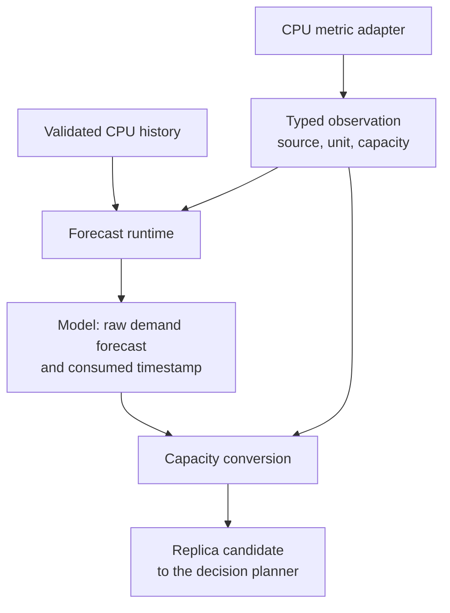

# Typed demand forecasting

All five built-in models forecast **aggregate CPU demand in millicores**. Memory, Object, Pods and External metrics
feed the reactive HPA recommendation where supported; configuring one does not make it a forecasting input.



`prediction.Observation` records source and unit, target identity, source ID and time, an integral value and the
current capacity. `MetricKind` identifies a dimension; the implemented pair is `resource.cpu` / `millicores`. Each
model declares the kinds it accepts and rejects an incompatible or missing kind before calling hooks or Python.
Stored `replicaHistory` rows carry the CPU: only rows with `totalCpuUsageMillicores` train these models, and replica
counts never become demand observations. Stored demand is an exact `int64`, including values beyond the exact range
of float64.

`DemandPredicter.ForecastDemand` returns demand plus the timestamp it actually consumed. Linear, Holt-Winters, both
trees and one-shot or incremental ARIMA use this interface. They don't convert to replicas or read capacity to
produce raw demand. Their Go replica methods wrap this interface and the same converter. The production router
rejects a model without typed forecasting, and there is no public API for custom models.

The runtime deep-copies the model and history, copies the observation, calls the selected model, checks
cancellation, and verifies that the result and the capacity refer to the same source, unit and target. The only
conversion policy is `cpu-request-utilization`:

```
replicas = ceil(max(forecast_millicores, 0) * 100 / (request_millicores_per_pod * target_utilization_percent))
```

Capacity must be positive even for zero demand. Big-integer arithmetic avoids intermediate overflow and rounding,
and a result beyond int32 is rejected. A failed or unsupported conversion adds no candidate. Min/max replicas,
stabilization, scaling policies, partial-metric protection and rollout modes still run in the planner afterwards.
The runtime emits one correlated debug record with source, unit, demand, replicas and the tree diagnostic scope.

Conversion uses the target's current capacity, not the capacity when the history was sampled. For example, 141m of
forecast demand at a 100m request and a 70% target needs three replicas; at a 200m request it needs two. The
converter can reuse the same raw demand without fitting again. The stored forecast cache keeps replicas and includes
the capacity in its fingerprint, so a capacity change invalidates it and may start a new fit.

Capacity is the **minimum live pod request**, capped by a smaller valid workload-template request. Raw API reads
include native sidecars and Pod-level resource overrides. Classic init peaks and runtime overhead stay outside the
steady-state application capacity. A known unsettled in-place resize makes utilization unavailable, and incomplete
pod or container observations never enter CPU training and block scale-down. See
[CPU capacity](cpu-capacity.md) for rounding, template identity, fallback, baseline behavior and cache timing.

Supporting another predictive metric means implementing and validating its collection and source identity, typed
history and version migration, the model capability declaration, the wire protocol and a demand-to-capacity policy.
Memory working set, request rate, queue drain time and business metrics cannot reuse the CPU utilization conversion.
Public configuration should only be added once freshness, overflow, compatibility and scaling safety are defined and
tested.
