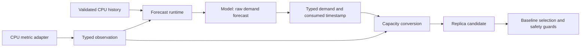

# Typed demand forecasting

All five built-in models forecast **aggregate CPU demand in millicores**. Kubernetes memory, object, pods and external
metrics remain available to the HPA baseline where supported; configuring one does not enable predictive support for it.
The public CRD, stored history and Python protocol retain their existing wire formats.



`prediction.Observation` records source/unit, target identity, source ID/time, integral value and current capacity.
`MetricKind` identifies a dimension: the implemented pair is `resource.cpu` / `millicores`. Each model declares its
accepted kinds and rejects an incompatible or missing kind before invoking hooks or Python. Historical `replicaHistory`
rows are an explicit CPU bridge: only `totalCPUUsageMillicores` rows train these models; replica counts never become
demand observations. Persisted demand remains exact `int64`, including values above the exact range of float64.

`DemandPredicter.ForecastDemand` returns demand plus the timestamp actually consumed. Linear, Holt-Winters, both trees,
and one-shot/incremental ARIMA use this interface. They do not perform replica conversion or read capacity to produce
raw demand. Their existing Go replica methods are compatibility wrappers around this interface and the same converter.
The production router rejects a registered model without typed forecasting; the legacy adapter fallback supports old
injected/test predictors, not a public custom-model extension API.

The runtime deep-copies model/history and copies the observation, invokes the selected model, checks cancellation,
and verifies that result and capacity refer to the same source, unit and target. The only conversion policy is
`cpu-request-utilization`:

```
replicas = ceil(max(forecast_millicores, 0) * 100 / (request_millicores_per_pod * target_utilization_percent))
```

Capacity must be positive even for zero demand. Big integer arithmetic avoids intermediate overflow and rounding;
a result beyond int32 is rejected. A failed or unsupported conversion contributes no candidate. Min/max replicas,
stabilization, scaling policies, partial-metrics protection and rollout modes still run in the planner afterward.
The runtime emits one correlated debug record with source, unit, demand, replicas and the tree diagnostic scope.

Conversion uses current target capacity, independently of the capacity that existed when history was sampled.
For example, 141m forecast demand at 100m request and 70% target requires three replicas; at 200m request it requires
two. The converter can reuse the same raw demand without fitting. The controller's existing persisted cache still
stores replicas and includes capacity in its fingerprint, so capacity changes still invalidate that cache and may
trigger a new fit. Raw-demand caching is not implied by this refactor.

Capacity selection now uses the **minimum live pod request**, capped by a smaller valid native workload-template
request. Raw API reads preserve native sidecars and Pod-level resource overrides even with the older pinned Go types.
Classic init peaks and runtime overhead stay outside steady-state application capacity. Known unsettled in-place
resizes make utilization unavailable; incomplete serving-container/pod observations never enter CPU training and
block downscaling. This deliberately replaces the earlier template-first / observed-mean policy for mixed/VPA pods.
See the [complete CPU capacity contract](cpu-capacity.md) for rounding, template identity, fallback, baseline behavior,
cache timing and compatibility.

To support another predictive metric, implement and validate its collection/source identity, typed history/version
migration, model capability declaration, wire protocol and demand-to-capacity policy. Memory working set, request
rate, queue drain time and business metrics cannot reuse CPU utilization conversion. Public configuration should be
added only after defining and validating freshness, overflow, compatibility and scaling-safety behavior.
