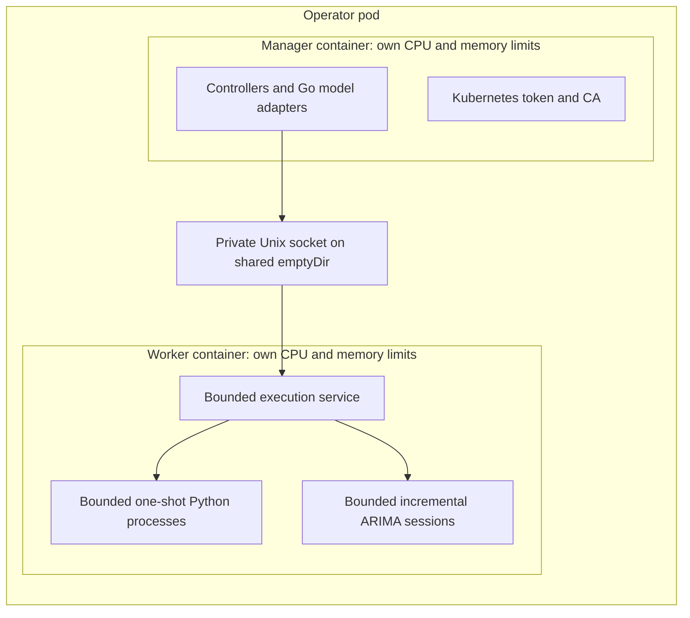

# Worker container isolation

Set `workerIsolation.enabled: true` to move **all Python execution** into a `model-workers` sidecar. It is off by
default. The operator image contains the worker server, `/app/worker-server`.

```yaml
image:
  repository: your-registry/hpa-plus
  tag: your-tested-version
workerIsolation:
  enabled: true
  resources:
    requests:
      cpu: 250m
      memory: 256Mi
    limits:
      cpu: "2"
      memory: 2Gi
  tmpSizeLimit: 128Mi
# These remain per-process / pool limits inside the worker container.
workers:
  memoryMiB: 1024
  concurrency: 4
  sessions: 16
```

Manager resources remain under `resources`. Worker limits are additional, separately enforced container cgroup limits;
include both containers when sizing nodes and quotas. The schema requires positive CPU and memory limits. Memory
values use positive whole bytes or integer quantities such as `768Mi`/`2Gi`; CPU supports positive cores or millicores.
The per-process address-space ceiling remains distinct from resident memory and aggregate container memory.

## Boundaries and behavior



The manager uses `--worker-socket=/var/run/hpaplus/worker.sock`. A versioned HTTP/JSON protocol travels only over that
socket, with an allowlist of bundled model scripts, strict fields, bounded payloads/replies and bounded request admission.
Opaque session keys are SHA-256 digests, so the bounded wire identifier puts no limit on model names. The protocol
carries model deadlines and cancellation. Cleanup calls have a separate three-second bound and can add that latency
after execution is canceled. Reset and cleanup requests retry only explicit busy-admission rejections, within their
three-second deadline. Execution is never retried automatically over the transport, because an interrupted
incremental request may have advanced the model state; the model adapter's reset and refit handle recovery. An
unavailable worker returns errors through the normal backoff and fallback rules, and Python is never started in the
manager container instead. Valid cached forecasts keep their normal expiry.

One shared worker container contains the model pool. A kernel OOM may kill a Python child or restart that container,
while the manager has its own cgroup. This does not assign a separate cgroup to each model, guarantee a particular OOM
victim, or isolate workers from each other. Both containers share the pod network and the host kernel, so there are
no separate network rules per container, no per-model containers and no stronger tenant isolation.

The pod disables automatic service-account token mounting. Only the manager receives a projected token, CA and
namespace volume. Workers have their own bounded scratch volume and no Kubernetes credentials. Both containers run as
UID/GID 65532 with a read-only root, dropped capabilities and RuntimeDefault seccomp. The socket is mode 0600; its
emptyDir is shared only by these two containers. This is a trusted bundled-code execution service, not a public API.

A new manager's first request clears resident sessions before starting work, preventing removed models from leaving
orphan sessions across manager restarts. Worker restarts lose in-memory sessions; adapters rebuild from persisted
history. Shutdown cancels in-flight calls and requests session cleanup. A lock protects the socket path, and startup
removes only a stale socket while holding that lock; regular files and symlinks are not replaced.

## Health and metrics

The sidecar's startup/readiness/liveness probes use HTTP `/healthz` on port 8082. Each request checks the actual private
Unix socket with a one-second deadline; Kubernetes allows two seconds for the HTTP probe. This avoids spawning a new
exec process for every probe under load. A failed or unresponsive socket returns a sanitized 503. Health checks bypass
execution admission, so a full model queue does not make the worker unhealthy. The manager remains independently healthy while
forecasts are unavailable; Kubernetes pod readiness also reflects sidecar readiness.

Scrape manager metrics on port 8080 and worker metrics on port 8082. Worker process and exchange activity, lifecycle
and queue metrics are on the worker endpoint; forecast outcomes, decisions, history I/O and controller metrics are on
the manager endpoint. Keep endpoint/container labels when aggregating process metrics. Port 8082 is read-only
metrics and socket health only; the execution API has no TCP listener. Unknown routes return 404.

`workerIsolation.probeTransport: exec` runs `/app/worker-server --check` as an exec probe instead of the HTTP check.
The default `http` avoids starting a process for every probe. A Helm rollback restores the previous probe
configuration.
