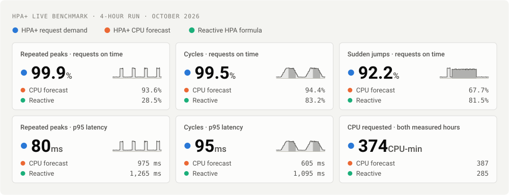
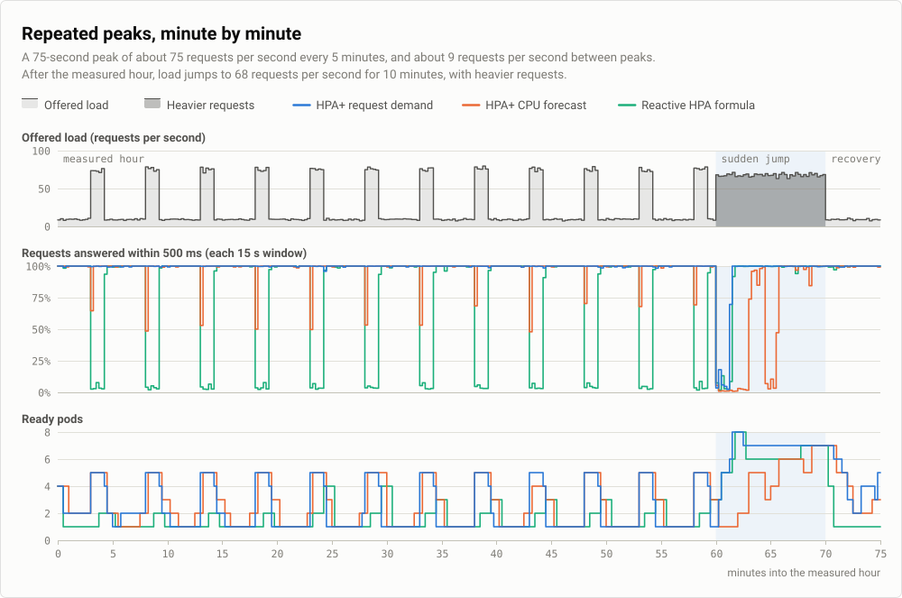
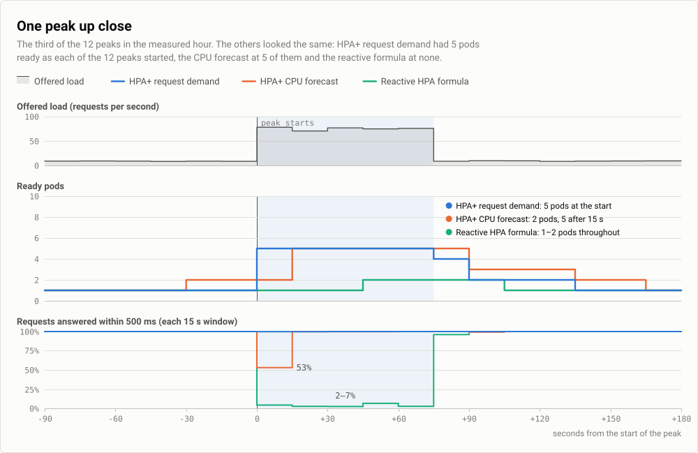
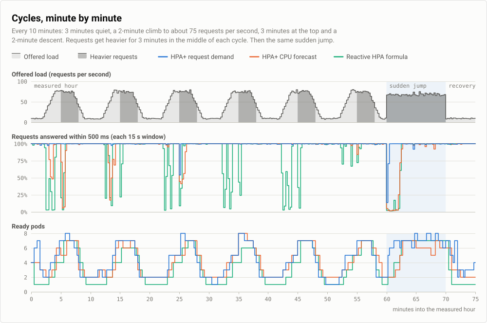
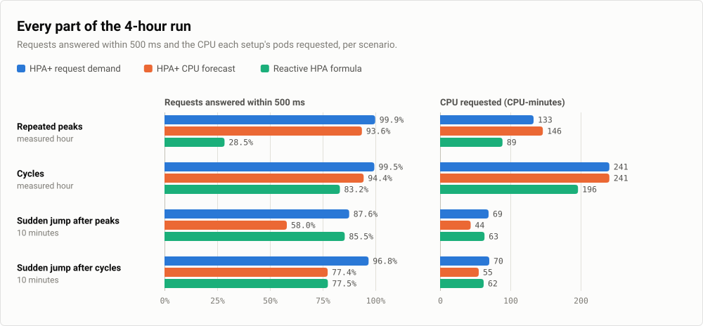
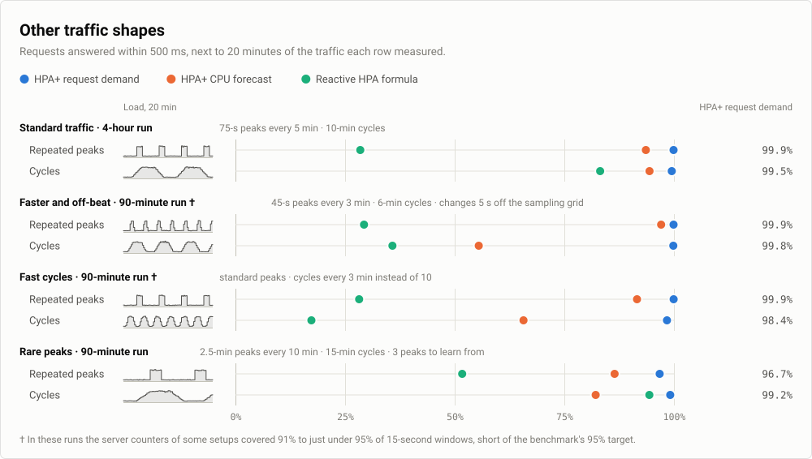

# Benchmark results

HPA+ was tested on a live Kubernetes cluster against two other ways of scaling the same application under the same traffic. In a 4-hour run, HPA+ with request-demand forecasting answered 99.9% of requests within 500 ms during repeated traffic peaks and 99.5% during slower cycles. HPA+ forecasting from CPU alone answered 93.6% and 94.4%, and the reactive HPA formula 28.5% and 83.2%. Over both measured hours, its pods requested 3% less CPU than the CPU forecast's and 31% more than the reactive formula's.

This page first shows the traffic and the three setups, then the results.

## The traffic


The requests came in two kinds: a checkout uses three times the CPU of a browse. Normally 20% of requests were checkouts. The darker areas mark the times when more of them were: 60% for 3 minutes in the middle of each cycle and 70% during the sudden jump. The same number of requests per second can therefore need very different amounts of CPU.

While learning, the autoscalers only watched, so the two forecasting setups had collected history before they took control. Only the measured hour and the sudden jump count in the results, and the first 2 minutes of the measured hour are not scored.

## What was compared

Three copies of the same application received the same requests at the same times. Each copy was scaled by its own `HPAPlus` resource.

| Setup | How it decides the pod count |
| --- | --- |
| **HPA+ request demand** | The opt-in [request-demand mode](../user-guide/request-demand.md) with `forecastTarget: reconstructedCPU`. It rebuilds the CPU demand of each 30-second window from measured CPU and the requests that arrived and completed, so a saturated pod no longer hides the work it could not serve. An XGBoost model forecasts that demand 90 seconds ahead, and HPA+ starts pods early enough to be ready when a forecast rise arrives. It never recommends fewer pods than the current demand needs. |
| **HPA+ CPU forecast** | The same XGBoost model and settings, forecasting from CPU history alone. |
| **Reactive HPA formula** | HPA+ with no models and `includeHPA: true`: the Kubernetes HPA formula applied to current CPU. |

All three used a 60% CPU target, 1 to 8 pods with 1 CPU each and a 30-second sync period. They shared the same scaling limits: when scaling up, at most double or 4 more pods per 60 seconds; when scaling down, any amount per 30 seconds, with no stabilization window.

## Results at a glance



The large numbers are HPA+ with request demand; the two rows under each are the other setups. The small chart in each tile is 20 minutes of the traffic that tile measured. These results come from one application on one cluster. Read the [limits](#limits) before applying them to your workload.

## Repeated peaks



HPA+ with request demand answered nearly every request in time through all 12 peaks of the measured hour. The reactive formula sees only CPU, and a pod cannot use more than its 1 CPU however many requests are waiting. Each scaling step could therefore ask for at most 1.7 times the current pods (100% ÷ 60%, rounded up), and every peak ended before the reactive formula got past 2 pods. The CPU forecast had 5 pods ready at 5 of the 12 peaks and caught up within the first 15 seconds of the others.



Request demand also released pods sooner after each peak, so its pods requested 9% less CPU than the CPU forecast's in this scenario (133 against 146 CPU-minutes).

## Cycles



When requests got heavier in the middle of each cycle, the same request rate needed about 1.5 times the CPU. Request demand followed both the climbs and the heavier requests, and answered 99.5% of requests in time. The CPU forecast answered 94.4% with exactly the same CPU (240.75 CPU-minutes each). The reactive formula fell behind on each climb and each switch to heavier requests, and answered 83.2%.

## Sudden jump

After each measured hour, load jumped to 68 requests per second for 10 minutes, and 70% of requests were the expensive kind. That needs about one and a half times the CPU of a normal peak, and it arrives as a single step that lasts 10 minutes. No forecast can predict a jump like this, so HPA+ with request demand relied on the demand it had just measured. It answered 87.6% of requests in time after the peaks and 96.8% after the cycles. The reactive formula answered 85.5% and 77.5%, and the CPU forecast 58.0% and 77.4%.

## CPU used and CPU requested


Each pod requested 1 CPU, so the line also counts running pods. The gap between the line and the shaded area is requested CPU that sat idle. That gap is what lets a setup absorb a rise without making requests wait.

- **HPA+ request demand** raised its request just before each peak and lowered it soon after.
- **HPA+ CPU forecast** often raised its request at the start of a peak and kept it longer afterwards. In the peaks scenario that cost 13 more CPU-minutes for fewer requests on time.
- **The reactive formula** left almost no gap. Its pods used all the CPU they requested during all 12 peaks and in 5 of the 6 cycles, so requests queued. Its CPU use was the highest share of what it requested, but only because its pods were overloaded.

Share of the requested CPU that was used:

| Setup | Repeated peaks | Cycles | Sudden jump after peaks | Sudden jump after cycles |
| --- | ---: | ---: | ---: | ---: |
| HPA+ request demand | 39.0% | 45.0% | 56.5% | 55.2% |
| HPA+ CPU forecast | 35.5% | 45.9% | 72.7% | 65.1% |
| Reactive HPA formula | 43.9% | 56.0% | 62.4% | 59.7% |

All three setups target 60%. A setup that adds pods before a rise runs below that target between rises, and HPA+ request demand never recommends fewer pods than the current demand needs at 60%. During the sudden jump, the CPU forecast's high figure came from overloaded pods: it answered only 58.0% and 77.4% of requests in time.

## All numbers



| Scenario | Setup | On time | Missed | Errors | p95 | CPU-min |
| --- | --- | ---: | ---: | ---: | ---: | ---: |
| Repeated peaks<br>measured hour, 91,312 requests | HPA+ request demand | 99.91% | 78 | 0.02% | 80 ms | 133.0 |
| | HPA+ CPU forecast | 93.60% | 5,847 | 2.41% | 975 ms | 146.3 |
| | Reactive HPA formula | 28.46% | 65,328 | 34.90% | 1,265 ms | 88.8 |
| Cycles<br>measured hour, 150,612 requests | HPA+ request demand | 99.50% | 754 | 0.07% | 95 ms | 240.8 |
| | HPA+ CPU forecast | 94.42% | 8,403 | 0.47% | 605 ms | 240.8 |
| | Reactive HPA formula | 83.17% | 25,345 | 3.15% | 1,095 ms | 196.3 |
| Sudden jump after peaks<br>10 minutes, 40,643 requests | HPA+ request demand | 87.57% | 5,053 | 3.06% | 1,090 ms | 69.0 |
| | HPA+ CPU forecast | 57.99% | 17,076 | 23.89% | 1,295 ms | 43.5 |
| | Reactive HPA formula | 85.46% | 5,908 | 2.94% | 1,175 ms | 63.3 |
| Sudden jump after cycles<br>10 minutes, 40,666 requests | HPA+ request demand | 96.78% | 1,309 | 1.08% | 180 ms | 70.0 |
| | HPA+ CPU forecast | 77.35% | 9,210 | 11.31% | 1,265 ms | 55.0 |
| | Reactive HPA formula | 77.45% | 9,169 | 9.98% | 1,245 ms | 62.0 |

*On time* is the share of requests answered successfully within 500 ms. *Missed* counts every other request: late answers, errors and timeouts. *Errors* includes rejected and timed-out requests. *p95* is the latency within which 95% of requests were answered. *CPU-min* is the CPU requested by running pods over time, in CPU-minutes; each pod requests 1 CPU.

## Other traffic shapes

Shorter runs repeated the comparison on three other traffic shapes. Each 90-minute run had 35 minutes of learning traffic, a 5-minute even start, 20 minutes of peaks, 20 minutes of cycles, a 5-minute sudden jump and 5 minutes of recovery. As in the 4-hour run, the first 2 minutes of the peaks and of the cycles are not scored.



| Traffic | Scenario | HPA+ request demand | HPA+ CPU forecast | Reactive HPA formula |
| --- | --- | ---: | ---: | ---: |
| Faster and off-beat † | Repeated peaks | 99.9% · 59.0 | 97.1% · 57.3 | 29.3% · 25.8 |
| | Cycles | 99.8% · 81.0 | 55.5% · 65.0 | 35.8% · 51.8 |
| | Sudden jump | 95.2% · 34.5 | 54.4% · 26.3 | 70.7% · 29.8 |
| Fast cycles † | Repeated peaks | 99.9% · 48.5 | 91.6% · 48.0 | 28.2% · 30.5 |
| | Cycles | 98.4% · 86.0 | 65.7% · 68.8 | 17.3% · 42.0 |
| | Sudden jump | 99.9% · 33.8 | 47.1% · 20.5 | 72.1% · 28.0 |
| Rare peaks | Repeated peaks | 96.7% · 44.5 | 86.5% · 39.5 | 51.7% · 29.3 |
| | Cycles | 99.2% · 72.0 | 82.2% · 61.0 | 94.4% · 55.5 |
| | Sudden jump | 99.9% · 33.8 | 90.9% · 33.0 | 81.6% · 30.0 |

Each cell shows the share of requests on time, then the CPU-minutes requested.

- **Faster and off-beat**: 45-second peaks every 3 minutes and cycles every 6 minutes, each change starting 5 seconds after a 30-second sampling boundary.
- **Fast cycles**: the standard peaks, then cycles every 3 minutes instead of 10.
- **Rare peaks**: 2.5-minute peaks every 10 minutes and cycles every 15 minutes, which leaves only 3 peaks to learn from.

Request demand answered at least 96.7% of requests in time in every scenario. On these shapes its pods also requested more CPU than both other setups in every scenario, for example 1% to 25% more than the CPU forecast in the peaks and cycles. Rare peaks were the hardest: nearly all of the 963 requests it missed there came at the first of the two scored peaks, when it had 2 pods ready.

† In these runs the server-side request counters of some setups covered 91% to just under 95% of 15-second windows, short of the benchmark's own 95% target. Their numbers are less certain than the others.

## Limits

- **One application.** The test service is CPU-bound. Workloads limited by memory, I/O or downstream services were not tested.
- **Few runs.** The 4-hour result is a single run per scenario. Repeated 90-minute runs with the same code and traffic differed by up to several percentage points in the share of requests on time, so treat small differences as noise.
- **The reactive setup is not a default Kubernetes HPA.** It reacted every 30 seconds and removed pods without the default 5-minute scale-down stabilization window. A default HPA keeps more pods after each peak; that configuration was not tested.
- **Request demand needs request metrics.** It reads per-pod request counters from Prometheus and CPU from the HPA+ cgroup collector; see the [request-demand guide](../user-guide/request-demand.md). Without them, HPA+ forecasts from CPU alone, like the second setup.
- **It costs more than reacting late.** Request demand's pods requested 31% more CPU than the reactive formula's over the two measured hours, because its pods were ready before each rise rather than after it.
- **Scale-up period.** All setups could add pods once per 60 seconds. The HPA+ default is 15 seconds, as in Kubernetes, which lets every setup grow faster; these runs did not measure it.
- **Fast pod start.** Pods in this test were ready 1 to 3 seconds after they were created. Applications that start slowly leave less time to react.

## How the test was run

- **Cluster.** The three copies of the application ran on three worker nodes of an on-premises Kubernetes cluster. The HPA+ operator, the traffic generator and Prometheus ran on a separate node.
- **Application.** A Python HTTP service with two request types: a checkout does three times the CPU work of a browse. Each pod requests and is limited to 1 CPU and works on at most 4 requests at once. It rejects a request that cannot start within 1 second or that arrives when 64 are already in flight.
- **Traffic.** One generator sent the same request schedule to each copy, following the plan under [The traffic](#the-traffic).
- **Scoring.** A request counts as on time when it returns a successful response within 500 ms. Requests time out after 3 seconds. The first 2 minutes of each measured hour are not scored.
- **When.** The 4-hour run took place on 25 October 2026 and the 90-minute runs between 25 and 27 October 2026, with the request-demand code as it was then.

<details>
<summary>HPAPlus specification of the request-demand setup</summary>

The metric names are the test application's own counters. The other two setups used the same specification without `requestDemand` and `scaleUpLeadFromStartup`; the reactive setup also had no models and `includeHPA: true`.

```yaml
spec:
  scaleTargetRef:
    apiVersion: apps/v1
    kind: Deployment
    name: request-demand
  minReplicas: 1
  maxReplicas: 8
  syncPeriod: 30000
  includeHPA: false
  decisionType: maximum
  predictionFailurePolicy: HoldCurrent
  metrics:
    - type: Resource
      resource:
        name: cpu
        target:
          type: Utilization
          averageUtilization: 60
  behavior:
    scaleUp:
      stabilizationWindowSeconds: 0
      selectPolicy: Max
      policies:
        - type: Percent
          value: 100
          periodSeconds: 60
        - type: Pods
          value: 4
          periodSeconds: 60
    scaleDown:
      stabilizationWindowSeconds: 0
      policies:
        - type: Percent
          value: 100
          periodSeconds: 30
  models:
    - name: xgboost
      type: XGBoost
      perSyncPeriod: 1
      calculationTimeout: 30000
      predictionMaxAge: 120000
      predictivePolicy:
        scaleUpLeadSeconds: 30
        scaleUpLeadFromStartup: true
        tolerance: 0.1
      xgboost:
        historySize: 60
        lags: 12
        lookAhead: 90000
        forecastStrategy: direct
        forecastAggregation: last
        seasonalFeatures: true
        nEstimators: 300
        maxDepth: 5
        learningRate: 0.1
        subsample: 0.8
        objective: reg:quantileerror
        quantileAlpha: 0.95
      requestDemand:
        forecastTarget: reconstructedCPU
        traffic:
          provider: prometheus
          arrivalsMetric: hpaplus_http_requests_started_total
          completionsMetric: hpaplus_work_requests_completed_total
          outcomesMetric: hpaplus_http_requests_completed_total
          errorsMetric: hpaplus_http_errors_total
          latencyBucketMetric: hpaplus_http_request_duration_seconds_bucket
          arrivalSemantics: started
          completionSemantics: finished
          retrySemantics: attempts
          maxAgeSeconds: 3
```

</details>
