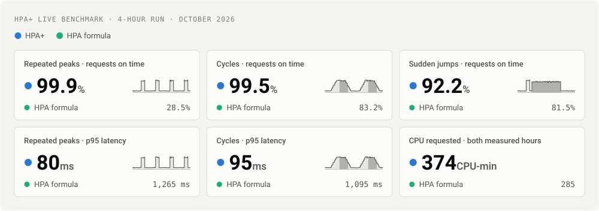
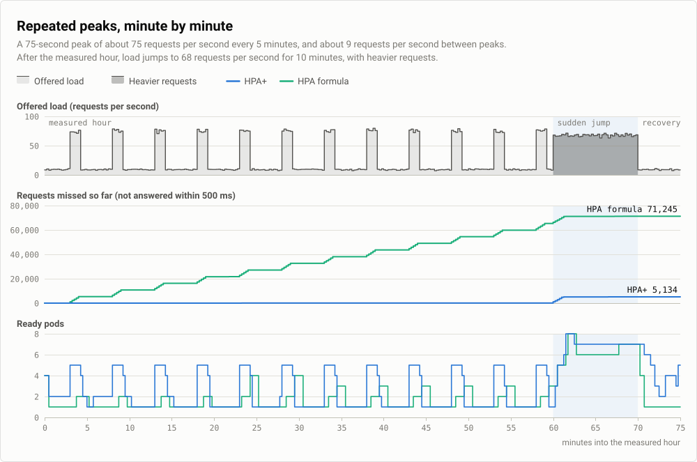
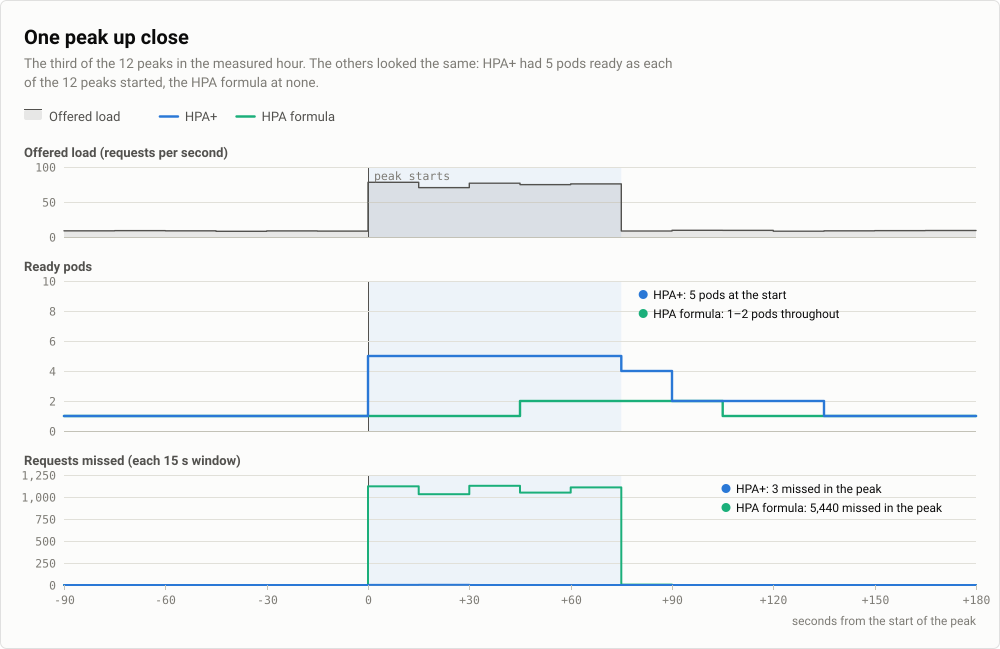
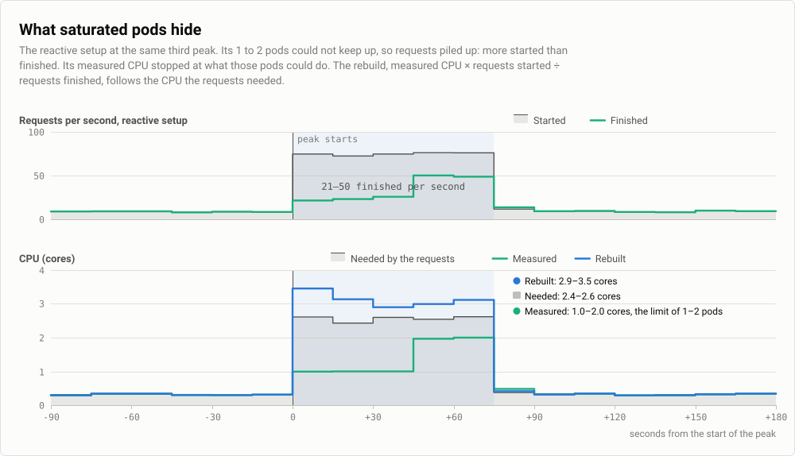
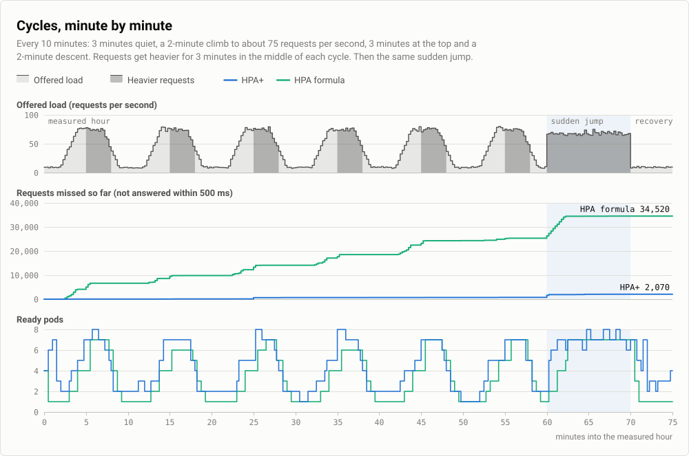
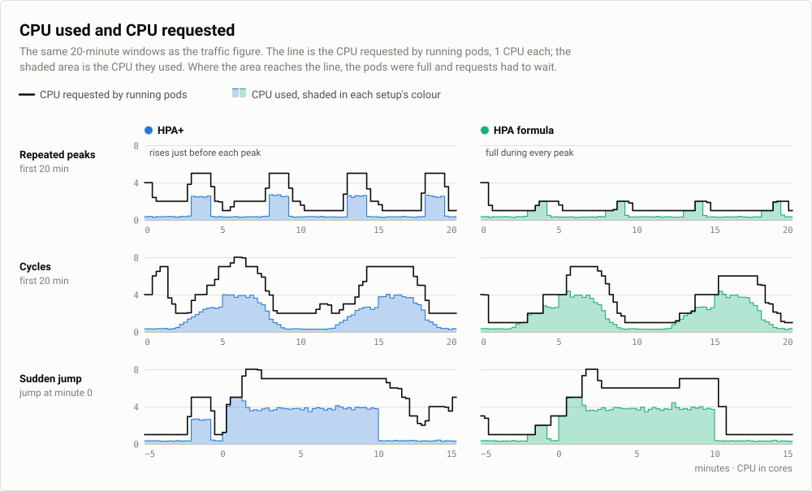
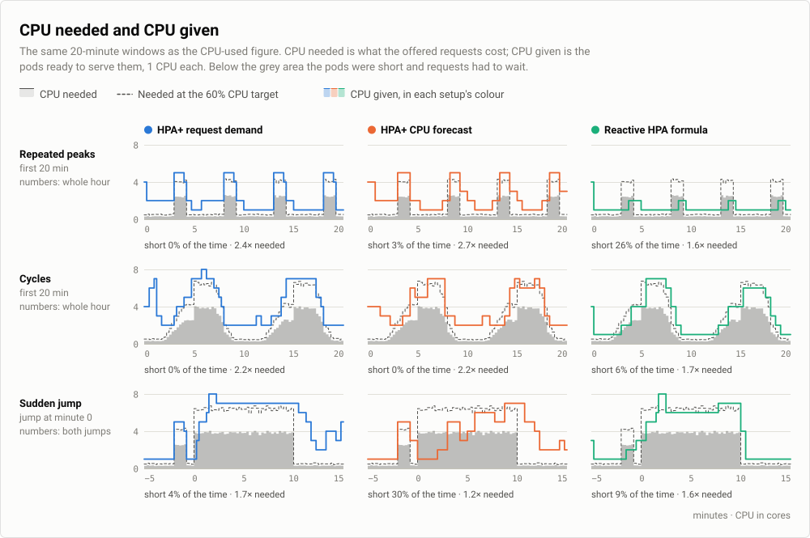
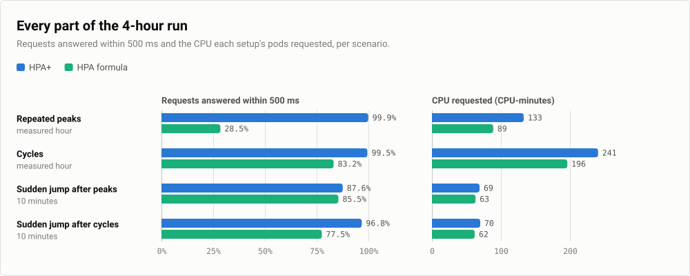
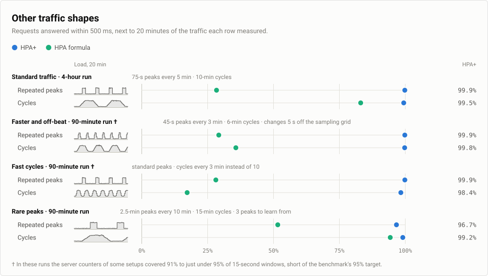

# Synthetic traffic

The 4-hour run on traffic with known shapes: repeated peaks, slow cycles and a sudden jump. Because the shapes are
declared, the demand of every moment is known exactly. The setups are described on the [overview](README.md#what-was-compared).

In this run HPA+ answered 99.9% of requests within 500 ms during repeated traffic peaks and 99.5% during slower
cycles. The HPA formula answered 28.5% and 83.2%. Over both measured hours, HPA+'s pods requested 31% more CPU than the
HPA formula's.

## The traffic


The requests came in two kinds: a checkout uses three times the CPU of a browse. Normally 20% of requests were checkouts. The darker areas mark the times when more of them were: 60% for 3 minutes in the middle of each cycle and 70% during the sudden jump. The same number of requests per second can therefore need very different amounts of CPU.

While learning, the autoscalers only watched, so HPA+ had collected history before it took control. Only the measured hour and the sudden jump count in the results, and the first 2 minutes of the measured hour are not scored.

## Results at a glance



The large numbers are HPA+; the row under each is the HPA formula. The small chart in each tile is 20 minutes of the traffic that tile measured. These results come from one application on one cluster. Read the [limits](#limits-of-this-run) and the [general limits](README.md#limits) before applying them to your workload.

## Repeated peaks



HPA+ answered nearly every request in time through all 12 peaks of the measured hour. The HPA formula sees only CPU, and a pod cannot use more than its 1 CPU however many requests are waiting. Each scaling step could therefore ask for at most 1.7 times the current pods (100% ÷ 60%, rounded up), and every peak ended before the HPA formula got past 2 pods.



The HPA formula setup at the same peak shows what full pods hide. Requests started much faster than they finished, its measured CPU stopped at what its 1 to 2 pods could do, and the rebuild came close to the CPU the requests needed:



## Cycles



When requests got heavier in the middle of each cycle, the same request rate needed about 1.5 times the CPU. HPA+ followed both the climbs and the heavier requests, and answered 99.5% of requests in time. The HPA formula fell behind on each climb and each switch to heavier requests, and answered 83.2%.

## Sudden jump

After each measured hour, load jumped to 68 requests per second for 10 minutes, and 70% of requests were the expensive kind. That needs about one and a half times the CPU of a normal peak, and it arrives as a single step that lasts 10 minutes. No forecast can predict a jump like this, so HPA+ relied on the demand it had just measured. It answered 87.6% of requests in time after the peaks and 96.8% after the cycles. The HPA formula answered 85.5% and 77.5%.

## CPU used and CPU requested



Each pod requested 1 CPU, so the line also counts running pods. The gap between the line and the shaded area is requested CPU that sat idle. That gap is what lets a setup absorb a rise without making requests wait.

- **HPA+** raised its request just before each peak and lowered it soon after.
- **The HPA formula** left almost no gap. Its pods used all the CPU they requested during all 12 peaks and in 5 of the 6 cycles, so requests queued. Its CPU use was the higher share of what it requested, but only because its pods were overloaded.

Share of the requested CPU that was used:

| Setup | Repeated peaks | Cycles | Sudden jump after peaks | Sudden jump after cycles |
| --- | ---: | ---: | ---: | ---: |
| HPA+ | 39.0% | 45.0% | 56.5% | 55.2% |
| HPA formula | 43.9% | 56.0% | 62.4% | 59.7% |

Both setups target 60%. A setup that adds pods before a rise runs below that target between rises, and HPA+ never recommends fewer pods than the current demand needs at 60%.

## CPU needed and CPU given

CPU used cannot show a shortage: full pods use all their CPU however many requests wait. This figure compares the CPU
the offered requests needed with the CPU of the pods ready to serve them. CPU needed is the request rate times the CPU
per request, with a checkout costing three browses; that cost was fitted on every 15-second window of the run that met
the SLO (R² 0.998). CPU given counts pods ready at the start of each window, 1 CPU each.



At the 60% target a setup would give 1.67 times the CPU needed. HPA+ gave more, 2.2 to 2.4 times in the measured
hours, because it adds pods before each rise and holds them while demand is still rising. In exchange it was never
short in either hour. The HPA formula gave less and was short a quarter of the peaks hour.

## All numbers



| Scenario | Setup | On time | Missed | Errors | p95 | CPU-min |
| --- | --- | ---: | ---: | ---: | ---: | ---: |
| Repeated peaks<br>measured hour, 91,312 requests | HPA+ | 99.91% | 78 | 0.02% | 80 ms | 133.0 |
| | HPA formula | 28.46% | 65,328 | 34.90% | 1,265 ms | 88.8 |
| Cycles<br>measured hour, 150,612 requests | HPA+ | 99.50% | 754 | 0.07% | 95 ms | 240.8 |
| | HPA formula | 83.17% | 25,345 | 3.15% | 1,095 ms | 196.3 |
| Sudden jump after peaks<br>10 minutes, 40,643 requests | HPA+ | 87.57% | 5,053 | 3.06% | 1,090 ms | 69.0 |
| | HPA formula | 85.46% | 5,908 | 2.94% | 1,175 ms | 63.3 |
| Sudden jump after cycles<br>10 minutes, 40,666 requests | HPA+ | 96.78% | 1,309 | 1.08% | 180 ms | 70.0 |
| | HPA formula | 77.45% | 9,169 | 9.98% | 1,245 ms | 62.0 |

*On time* is the share of requests answered successfully within 500 ms. *Missed* counts every other request: late answers, errors and timeouts. *Errors* includes rejected and timed-out requests. *p95* is the latency within which 95% of requests were answered. *CPU-min* is the CPU requested by running pods over time, in CPU-minutes; each pod requests 1 CPU.

## Other traffic shapes

Shorter runs repeated the comparison on three other traffic shapes. Each 90-minute run had 35 minutes of learning traffic, a 5-minute even start, 20 minutes of peaks, 20 minutes of cycles, a 5-minute sudden jump and 5 minutes of recovery. As in the 4-hour run, the first 2 minutes of the peaks and of the cycles are not scored.



| Traffic | Scenario | HPA+ | HPA formula |
| --- | --- | ---: | ---: |
| Faster and off-beat † | Repeated peaks | 99.9% · 59.0 | 29.3% · 25.8 |
| | Cycles | 99.8% · 81.0 | 35.8% · 51.8 |
| | Sudden jump | 95.2% · 34.5 | 70.7% · 29.8 |
| Fast cycles † | Repeated peaks | 99.9% · 48.5 | 28.2% · 30.5 |
| | Cycles | 98.4% · 86.0 | 17.3% · 42.0 |
| | Sudden jump | 99.9% · 33.8 | 72.1% · 28.0 |
| Rare peaks | Repeated peaks | 96.7% · 44.5 | 51.7% · 29.3 |
| | Cycles | 99.2% · 72.0 | 94.4% · 55.5 |
| | Sudden jump | 99.9% · 33.8 | 81.6% · 30.0 |

Each cell shows the share of requests on time, then the CPU-minutes requested.

- **Faster and off-beat**: 45-second peaks every 3 minutes and cycles every 6 minutes, each change starting 5 seconds after a 30-second sampling boundary.
- **Fast cycles**: the standard peaks, then cycles every 3 minutes instead of 10.
- **Rare peaks**: 2.5-minute peaks every 10 minutes and cycles every 15 minutes, which leaves only 3 peaks to learn from.

HPA+ answered at least 96.7% of requests in time in every scenario, and its pods requested more CPU than the HPA formula's in every scenario. Rare peaks were the hardest: nearly all of the 963 requests it missed there came at the first of the two scored peaks, when it had 2 pods ready.

† In these runs the server-side request counters of some setups covered 91% to just under 95% of 15-second windows, short of the benchmark's own 95% target. Their numbers are less certain than the others.

## Limits of this run

- **Few runs.** The 4-hour result is a single run per scenario. Repeated 90-minute runs with the same code and traffic differed by up to several percentage points in the share of requests on time, so treat small differences as noise.
- **It costs more than reacting late.** HPA+'s pods requested 31% more CPU than the HPA formula's over the two measured hours, because its pods were ready before each rise rather than after it.

## When and how it was configured

- **When.** The 4-hour run took place on 25 October 2026 and the 90-minute runs between 25 and 27 October 2026, with the request-demand code as it was then.

<details>
<summary>HPAPlus specification of the HPA+ setup</summary>

The metric names are the test application's own counters. The HPA formula setup used the same specification with no models and `includeHPA: true`.

```yaml
spec:
  scaleTargetRef:
    apiVersion: apps/v1
    kind: Deployment
    name: request-demand
  minReplicas: 1
  maxReplicas: 8
  syncPeriod: 30000
  includeHPA: false
  decisionType: maximum
  predictionFailurePolicy: HoldCurrent
  metrics:
    - type: Resource
      resource:
        name: cpu
        target:
          type: Utilization
          averageUtilization: 60
  behavior:
    scaleUp:
      stabilizationWindowSeconds: 0
      selectPolicy: Max
      policies:
        - type: Percent
          value: 100
          periodSeconds: 60
        - type: Pods
          value: 4
          periodSeconds: 60
    scaleDown:
      stabilizationWindowSeconds: 0
      policies:
        - type: Percent
          value: 100
          periodSeconds: 30
  models:
    - name: xgboost
      type: XGBoost
      perSyncPeriod: 1
      calculationTimeout: 30000
      predictionMaxAge: 120000
      predictivePolicy:
        scaleUpLeadSeconds: 30
        scaleUpLeadFromStartup: true
        tolerance: 0.1
      xgboost:
        historySize: 60
        lags: 12
        lookAhead: 90000
        forecastStrategy: direct
        forecastAggregation: last
        seasonalFeatures: true
        nEstimators: 300
        maxDepth: 5
        learningRate: 0.1
        subsample: 0.8
        objective: reg:quantileerror
        quantileAlpha: 0.95
      requestDemand:
        forecastTarget: reconstructedCPU
        traffic:
          provider: prometheus
          arrivalsMetric: hpaplus_http_requests_started_total
          completionsMetric: hpaplus_work_requests_completed_total
          outcomesMetric: hpaplus_http_requests_completed_total
          errorsMetric: hpaplus_http_errors_total
          latencyBucketMetric: hpaplus_http_request_duration_seconds_bucket
          arrivalSemantics: started
          completionSemantics: finished
          retrySemantics: attempts
          maxAgeSeconds: 3
```

</details>
