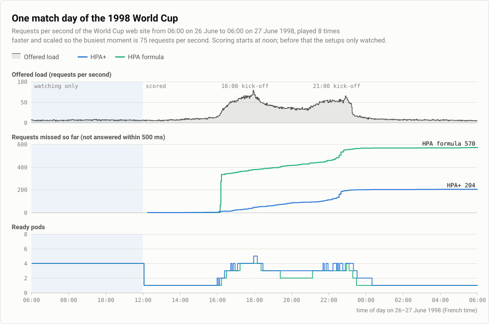

# Real traffic: 1998 World Cup

The same two setups as on the [overview](README.md#what-was-compared), HPA+ and the HPA formula, now on real traffic:
the requests the 1998 World Cup web site received on one match day. Three forecasting models were tried in HPA+, one
run each.

## The traffic

- **Source.** The access logs of the 1998 World Cup web site: M. Arlitt and T. Jin, "1998 World Cup Web Site Access
  Logs", August 1998, from the Internet Traffic Archive.
- **The day.** From 06:00 on 26 June to 06:00 on 27 June 1998, French time: 67.8 million requests. The morning is
  flat at 7 to 9% of the day's busiest moment. Load rises from 16:00 and again from 21:00, when that day's matches
  started, and drops after 23:30.
- **Replay.** The day was played 8 times faster, 24 hours in 3 hours, so 1 minute of the run is 8 minutes of the day.
  Each second of the run sends the mean rate of 8 recorded seconds, scaled so the busiest 8 seconds (3,121 requests per
  second) became 75 requests per second, the peak of the synthetic tests. 20% of requests were checkouts all day.
- **Learning and scoring.** From 06:00 to 11:20 the setups only watched, held at 4 pods; 11:20 to 12:00 was an even
  start. Scoring ran from 12:00 to 06:00.

## Results with XGBoost

| Setup | Requests on time | Missed | p95 | CPU requested |
| --- | ---: | ---: | ---: | ---: |
| HPA+ | 99.89% | 204 | 80 ms | 269.75 CPU-min |
| HPA formula | 99.70% | 570 | 95 ms | 235.00 CPU-min |

Out of 187,008 requests per setup. HPA+ missed less than half as many requests as the HPA formula, for 15% more CPU.

Most of the difference came at the 16:00 kick-off, when load doubled within about a minute of the run. HPA+ had a
second pod 5 seconds into the rise. The HPA formula added it about a minute later, once its one pod was full. The rest
of the day the two missed about the same.

## Three forecasting models

Each model ran once as HPA+'s forecaster, with the same history size and horizon. The HPA formula ran again in each
run.

| HPA+ model | Requests on time | Missed | CPU requested | HPA formula missed |
| --- | ---: | ---: | ---: | ---: |
| XGBoost | 99.89% | 204 | 269.75 CPU-min | 570 |
| Seasonal naive | 99.87% | 250 | 255.25 CPU-min | 497 |
| Toto | 99.89% | 203 | 270.00 CPU-min | 349 |

All three runs passed every check of the benchmark. On one day without an earlier day to learn from, the model
matters less than the rebuild: the request counts show the demand as it rises, whatever the model forecasts.

## Limits

- **One run per model, one day.** The HPA formula's misses varied from 349 to 570 between runs on the same traffic,
  so treat small differences between models as noise.
- **8 times faster.** Every rise is 8 times steeper than on the real site, and pods start in seconds either way.
- **No earlier day.** The models learned from the morning only, so none could learn the daily rhythm.
- The [general limits](README.md#limits) apply too.

## When and how it was run

- **When.** 12 November 2026, one 3-hour run per model, with the code of that day.
- **Settings.** As in the [synthetic run](synthetic.md#when-and-how-it-was-configured), including the 60-second scale-up
  limit. Seasonal naive and Toto used XGBoost's history size (60 samples) and horizon (90 seconds).
